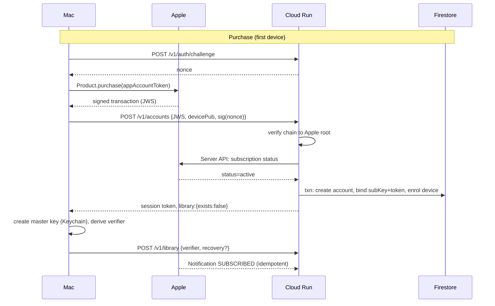
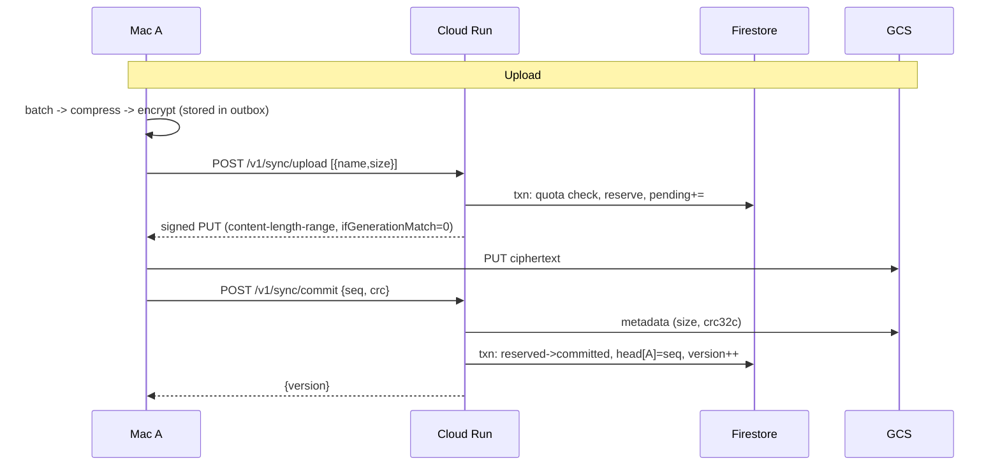
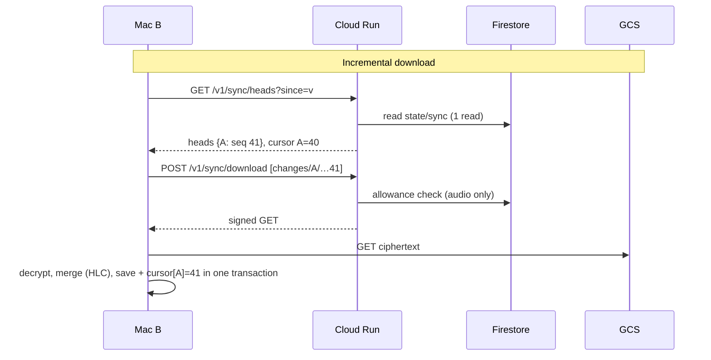
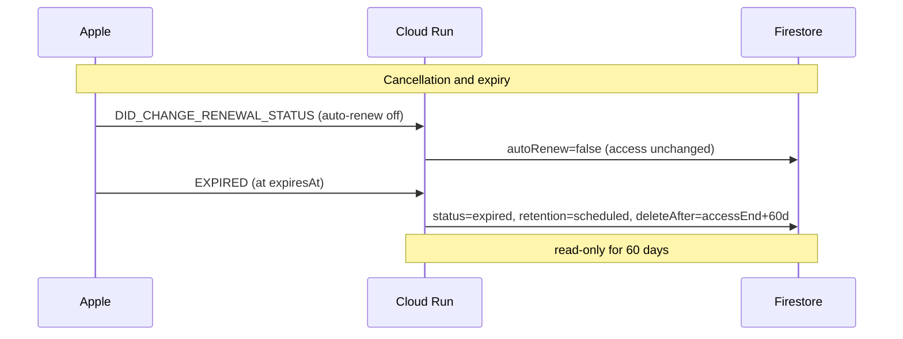
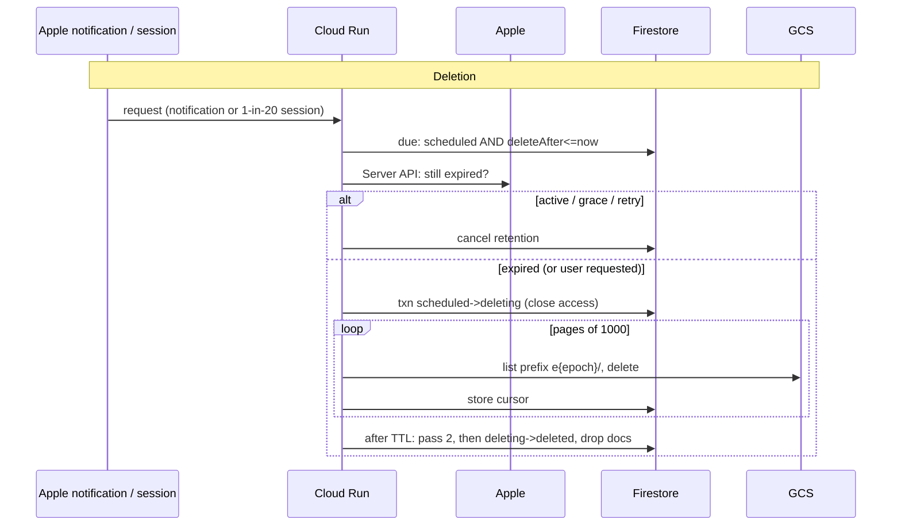

# Whisperer Cloud — implementation plan

Status: **proposed — awaiting approval gate 0** (2026-11-13). Mac App Store build only. Read `cloud-sync.md` (*Lean rules*, *Plans and margins*) first.
Baseline services (unchanged): **Cloud Run · Cloud Storage · Firestore · Secret Manager**. No additions.
No Cloud Scheduler: deletion rides on requests the server already handles (revised 2026-11-13 — see D10). Platform capabilities used without being application services: IAM, IAM Credentials (`signBlob`),
Artifact Registry (one 6 MB image), Cloud Logging/Monitoring (defaults), Resource Manager. Nothing else is enabled or planned.

## Implementation status (2026-11-13)

| Stage | State |
|---|---|
| A — identity, Apple, store | **Partly done.** Apple JWS + Notifications V2 + **Server API client** (ES256 JWT, sandbox fallback, never reads uncertainty as expiry), entitlement states incl. sealed/soft-deleted, **Firestore store**. *Not yet:* random `accountId` + device keypairs + key-proof enrolment (the server still derives the id as HMAC(originalTransactionId)) |
| B — storage control plane | **Done:** grants, quota reservations, commit/heads, download, delete, V4 signed URLs via IAM `signBlob` (incl. resumable start), Firestore transactions, guarded retention sweeper (no Scheduler) |
| C — deploy | not started (each command needs approval) |
| D — App Store Connect | not started |
| E — Mac purchase code | **Done** (StoreKit 2, App Store build only, `CloudFeature.isLive` off). *Not yet:* keys, crypto, enrolment |
| F–H — Mac sync engine, audio, UI | not started |

## 0. Decision log (alternatives → trade-offs → selected)

| # | Decision | Alternatives | Why selected / trade-off |
|---|---|---|---|
| D1 | **Identity** | (a) `HMAC(originalTransactionId)` as the user id; (b) Sign in with Apple; (c) random `accountId` bound to the subscription | **(c)** random 128-bit `accountId`; bound through `appAccountToken` + `originalTransactionId` mapping docs. (a) made the namespace a pure function of a value present in every receipt; (b) adds an account system and App Review obligations for no gain |
| D2 | **Proving ownership on a new Mac** | JWS only; JWS + email code; JWS + device key + library-key proof | **JWS + device keypair + proof of the library key.** A stolen JWS cannot enrol a device (attacker lacks the key); the server stores only a verifier, never the key |
| D3 | **Discovering new changes** | GCS `LIST` per poll; one Firestore doc per object; one small **heads doc**; push (APNs/Pub/Sub) | **Heads doc** (`sync/{accountId}`: version + per-device last sequence). One Firestore read per poll, **no LIST ever**, names are predictable. Push needs infrastructure we reject; poll cost is cents |
| D4 | **Upload ↔ metadata atomicity** | client writes metadata; server trusts client; **server commit that verifies the object** | **Commit**: object is invisible until `POST /v1/sync/commit` verifies it exists (size + crc32c) and advances the head in a Firestore transaction. An upload without commit is an orphan, never a half-visible state |
| D5 | **Conflict resolution** | device wall-clock LWW; HLC; CRDT; server sequencer | **Hybrid logical clock, corrected by server time**, row-level LWW with `(hlc, deviceId)` tiebreak. CRDT/sequencer are heavier than the data deserves; wall-clock LWW breaks under skew |
| D6 | **History growth** | replay all batches forever; periodic **snapshots** | **Snapshots** + garbage collection of covered batches; new Macs load snapshot + tail |
| D7 | **Quota accounting** | check on commit only; reconcile by LIST; **reservation → commit → rare reconcile** | **Reservation in Firestore transaction before any URL is signed**, corrected to real size on commit, reconciled by LIST only on demand/rarely. LIST-based accounting costs more than the storage |
| D8 | **Data-plane auth** | STS downscoped tokens; HMAC keys; **V4 signed URLs via IAM `signBlob`**; server-initiated resumable sessions for large objects | **V4 signed URLs** (small objects) + **server-initiated resumable sessions** (≥ 8 MB). No key files, no extra API |
| D9 | **Apple integration** | JWS verification only; + Notifications V2; + Server API | **All three**: StoreKit JWS = proof from the device, Notifications V2 = push of lifecycle events, **Server API = authority** and reconciliation. Firestore state is a *cache* of Apple's truth |
| D10 | **Deletion trigger** | one Cloud Scheduler job; GCS `customTime` lifecycle; Cloud Tasks; Eventarc; **opportunistic sweeps in requests** | **Opportunistic sweeps** (Apple notifications + a fraction of sessions), synchronous and bounded. Deletion happens 81–201 days after a subscription ends, so a day's delay costs cents and a precise timer buys nothing; Scheduler/Tasks/Eventarc would each be one more service. Lifecycle rules are object-age, not subscription-relative |
| D11 | **Key recovery material** | user-held only; server-held; wrapped blob in GCS; **wrapped blob in Firestore + user-held recovery key** | Primary key in iCloud Keychain; recovery key (user-held, never stored by us) wraps a copy of the master key; the *wrapped* blob (≈ 100 B) lives in the account doc so a new Mac can fetch it before enrolling |
| D12 | **Reset / key rotation** | in-place rewrite; **library epoch in the namespace** | `…/e{epoch}/…`. A reset or "re-encrypt" is: bump the epoch, upload under the new key, delete the old epoch later. Atomic, no partial states |
| D13 | **Firestore shape** | per-object docs; per-change docs; **few small docs per account** | One heads doc + one usage doc + one account doc: ≤ ~5 KB/account, ≤ 3 reads per request. Per-object docs would cost more than the storage they describe |
| D14 | **Sandbox vs production** | flag on documents; **separate roots** | `envs/{prod,sandbox}` Firestore roots and `whisperer/` vs `whisperer-sandbox/` GCS prefixes, sandbox limits ÷ 10, 14-day retention, account cap |
| D15 | **Tombstones** | forever; **90 days + stale-device rule** | See §9.6: a device offline past the horizon cannot resurrect deleted rows |

## 1. Architecture

```
                    ┌──────────────────────────── Apple ────────────────────────────┐
                    │  StoreKit 2 (on the Mac)   App Store Server API   ASSN V2 push │
                    └───────┬───────────────────────▲──────────────────────┬────────┘
   signed transactions (JWS)│                       │ JWT(ES256, IAP key)  │ signed notifications
                            │                       │ GET subscription     │ (Apple → us, retried)
┌─────────────┐             ▼                       │ status / history     ▼
│  Mac app    │   HTTPS   ┌──────────────────────────────────────────────────────────┐
│  SyncEngine │──────────▶│  Cloud Run  whisperer-api   (Go, scale-to-zero, ≤2 inst) │
│  encrypts   │◀──────────│  verify Apple · accounts/devices · quotas · sign URLs     │──▶ Secret Manager
│  locally    │ grants    │  · guarded retention sweep (inside requests)           │     (UID_SECRET,
└──────┬──────┘ (URLs)    └───────────┬───────────────────────────┬──────────────────┘      SESSION_KEY,
       │                              │ Firestore (control plane) │ IAM signBlob            IAP key .p8)
       │                              ▼                           ▼
       │                   ┌─────────────────────┐   (signs V4 URLs / starts resumable sessions as
       │                   │ Firestore (native)  │    whisperer-api@… — no key file exists)
       │  PUT / GET        │ accounts · devices  │
       │  ciphertext only  │ sync heads · usage  │
       └─────────────────────────────────┐       └─────────────────────┘
                                         ▼
                        ┌──────────────────────────────────────────────┐
                        │ GCS  gs://whisperer-491716-user-data         │
                        │ whisperer/users/{accountId}/e{epoch}/…       │   data plane: Mac ↔ GCS directly,
                        └──────────────────────────────────────────────┘   Cloud Run never proxies a byte
```

## 2. Identity, accounts, devices

### 2.1 Identifiers (all opaque, none derived from Apple data)

| Id | Form | Where it appears |
|---|---|---|
| `accountId` | 128-bit random, 32 hex chars, minted server-side | Firestore doc ids, GCS prefix, session token. Never in any receipt or Apple field |
| `appAccountToken` | UUIDv4 minted by the Mac, passed to `Product.purchase(options:[.appAccountToken])`; stored in the **synchronizable** Keychain | Apple embeds it in every transaction of that subscription → how the server recognises the same user after reinstall/new Mac |
| `subKey` | `HMAC(UID_SECRET, originalTransactionId)` hex | Firestore doc id of `subscriptions/{subKey}` → `accountId`. The raw transaction id is never stored as an id and never appears in GCS |
| `deviceId` | first 16 bytes of SHA-256 of the device's P-256 public key, hex | Firestore `devices/{deviceId}`; GCS `changes/{deviceId}/…` |

No email, Apple ID, name, or transaction id appears in any GCS path. Device display names are encrypted with the library key before upload.

### 2.2 Lookup cost

Session token (1 h, EdDSA) carries `{acct, dev, epoch, state, ro, exp}`; ordinary requests verify it with no database read. Resolving a user from Apple data is
**one document get** (`tokens/{appAccountToken}` or `subscriptions/{subKey}` → `accountId`). Objects are addressed by **known key**
`whisperer/users/{accountId}/e{epoch}/…/{name}`; the bucket is never listed to find a user.

### 2.3 Device ownership — three cases

1. **First device, new purchase** — `POST /v1/accounts` with the transaction JWS + device public key + signature over a server nonce. Server verifies the JWS, checks Apple (§6), finds no existing binding → creates the account, binds `originalTransactionId` and `appAccountToken`, enrols the device (authorised), returns a session token and `library:{exists:false}`.
2. **Known device** — `POST /v1/session` signed with the device key over a fresh nonce (replay-proof). Optional JWS refreshes the entitlement.
3. **New Mac, same Apple ID** (the case the review calls out) —
   `POST /v1/devices` (JWS + new device key + nonce signature) → the server resolves the account via the transaction's `appAccountToken`/`originalTransactionId`, creates a **pending** device (no data access) and returns only `{library:{exists, keyVersion, recoveryAvailable}, enrollChallenge}`. The Mac then obtains the library key (iCloud Keychain, or the recovery key — §10) and calls
   `POST /v1/devices/confirm {deviceId, keyProof}` where `keyProof = HMAC(authKey, enrollChallenge ‖ deviceId)` and `authKey = HKDF(libraryKey, "whisperer-auth-v1")`.
   The server compares against the stored **verifier** (`SHA-256(authKey)` from library creation) — it never sees the library key. Pending devices are purged after 7 days (Firestore TTL).
   *A valid JWS alone never reaches data*: it proves an entitlement, not knowledge of the key.

Rule: **binding a new `originalTransactionId` to an existing account** (resubscribe, upgrade chain) requires an authenticated enrolled device or the key proof — never a JWS plus token alone. (Prevents mapping injection by someone who learned a token.)

Device caps per plan: Starter 2, Standard 4, Large 8 (also a cost bound). Devices listed/revocable in Settings (`DELETE /v1/devices/{id}`); revocation takes effect at the next grant/commit (those routes read the device doc) and within 1 h for polls.

## 3. Firestore data model (control plane)

Root: `envs/{prod|sandbox}/…` (D14). Server-only access: the Cloud Run service account. Client SDK rules: deny-all (defence in depth; the Mac never talks to Firestore).

| Document | Fields (all small) | Size | Written when |
|---|---|---|---|
| `accounts/{accountId}` | `createdAt`, `appAccountToken`, `epoch`, `plan{productId,tier,period}`, `sub{originalTransactionIds[], status, expiresAt, graceUntil, autoRenew, autoRenewProductId, revokedAt, lastVerifiedAt, lastNotificationSignedDate, seen[16]}`, `library{exists, keyVersion, verifier, recovery{wrapped, kdf, createdAt}}`, `retention{state, deleteAfter, epochToDelete, cursor, passes, startedAt, deletedAt}`, `reconcile{nextAt}`, `purgeAt` | ≈ 1.5 KB | purchase, notification, plan change, library create/reset, retention step |
| `accounts/{id}/devices/{deviceId}` | `pubKey`, `labelEnc`, `state(pending/authorized/revoked)`, `enrolledAt`, `lastSeenAt`, `appVersion` | ≈ 250 B | enrol, revoke, `lastSeenAt` at most daily |
| `accounts/{id}/state/sync` | `version`(int), `heads{deviceId:{seq,crc}}`, `snapshot{id,covers{deviceId:seq},version}`, `tombstoneHorizon` | ≤ 1 KB | each commit (CAS) |
| `accounts/{id}/state/usage` | `committed`, `reserved`, `pending[{name,size,exp}]`(≤ 64), `month`, `downloadBytes`, `uploadGrants`, `lastReconciledAt` | ≤ 6 KB | each grant/commit/delete (transaction) |
| `subscriptions/{subKey}` | `accountId` | 60 B | account creation / binding |
| `tokens/{appAccountToken}` | `accountId` | 60 B | account creation |
| `devices_pending/{…}` | pending enrolments, TTL | — | enrol request |

Indexes: composite `(retention.state, retention.deleteAfter)` and single-field `reconcile.nextAt` (collection group `accounts`); TTL policies on `purgeAt` and pending enrolments. No other index.
Read budget: poll = **1 read** (`state/sync`); session = 2; grant = 3 (account, usage, device); commit = 3.

## 4. GCS namespace and objects

```
gs://whisperer-491716-user-data/
  whisperer/users/{accountId}/e{epoch}/
    changes/{deviceId}/{seq:012d}         immutable change batch (compressed JSON ops → AES-GCM)
    snapshots/{snapshotId}                full merged state at a point (tombstones within horizon)
    audio/{objectId}                      dictation audio packs (≤ 4 MB) — random 128-bit ids
    meetings/{objectId}                   meeting audio (chunk-encrypted) and Ask-AI threads
  whisperer-sandbox/users/…               sandbox accounts, separate prefix
```

- **Immutable**: every upload is created with `ifGenerationMatch=0` (signed into the URL / init request). A retry of an already-created object returns 412 = "exists"; the commit's crc32c check decides whether it is *our* object.
- Lifecycle (exists): objects ≥ 30 days Standard→Nearline by suffix; `snapshots/` and `changes/` stay Standard (small, re-read). No age-based deletion rule — deletion is per-account (§7).
- Bucket: private, uniform access, public-access-prevention enforced, soft delete off, no versioning.
- Epoch (D12): a reset/rotation bumps `e{epoch}`; the old epoch is deleted by the retention machinery.

## 5. API contracts (`/v1`, JSON; errors `{"error":code,"message":text}`)

Auth: `S` = session token; `D` = device-signed (nonce signature); `A` = Apple-signed payload. Every state-changing route is idempotent as noted.

| Route | Auth | Request → response | Notes / errors |
|---|---|---|---|
| `POST /v1/auth/challenge` | none (IP-limited) | `{deviceId}` → `{nonce, serverTime}` | nonce is a stateless MAC of `deviceId‖minute` (120 s): no storage |
| `POST /v1/accounts` | A + D | `{transactionJWS, devicePublicKey, nonce, sig}` → `{token, state, plan, library}` | creates or refuses; `409 already_bound` → use `/v1/devices`; verifies with Apple (§6) |
| `POST /v1/devices` | A + D | same → `{library:{exists,keyVersion,recoveryAvailable}, enrollChallenge}` | pending device, no data access |
| `POST /v1/devices/confirm` | D | `{deviceId, keyProof}` → `{token}` | `403 bad_key_proof` (rate-limited, 5/h) |
| `POST /v1/session` | D (+A optional) | `{deviceId, nonce, sig, transactionJWS?}` → `{token, expiresAt, state, readOnly, plan, library, serverTime}` | 1 h token |
| `GET /v1/account` | S | → `{state, plan, paidUntil, autoRenew, retention{deleteAfter?}, usage, devices[]}` | |
| `DELETE /v1/devices/{id}` | S | → 204 | |
| `POST /v1/library` | S | `{keyVerifier, recovery?{wrapped,kdf}}` → 201 | create-if-absent; `409 library_exists` (the caller must adopt the existing key, never keep a new one) |
| `PUT /v1/library/recovery` | S + keyProof | `{wrapped,kdf}` → 204 | replace recovery blob |
| `POST /v1/library/recovery-blob` | pending D + A | → `{wrapped,kdf,keyVersion}` | usable before enrolment; useless without the recovery key |
| `POST /v1/library/reset` | S + confirmation phrase | → `{epoch}` | bumps epoch; old epoch queued for deletion |
| `GET /v1/sync/heads?since=v` | S | → `{version, heads, snapshot, tombstoneHorizon, serverTime, state, readOnly}` (304-style when unchanged) | **1 Firestore read** |
| `POST /v1/sync/upload` | S (write) | `[{name,size,kind}]` ≤ 50 → `[{name,url|session,expiresAt}]` | quota reservation (§8); `402 over_quota`, `403 read_only`, `429` |
| `POST /v1/sync/commit` | S (write) | `{deviceId, seq, crc, names[]}` → `{version, head}` | idempotent: same `seq`+`crc` returns OK |
| `POST /v1/sync/download` | S (read) | `[name]` ≤ 50 → `[{name,url,expiresAt}]` | allowance checked (audio only); names must be under the caller's prefix |
| `POST /v1/sync/delete` | S (write) | `[name]` → counts | server reads the real size first (Class B) to decrement `committed` |
| `DELETE /v1/account/data` | S + confirmation | → `{retention:{state:"deleting"}}` | user-requested erasure (§7) |
| `POST /v1/apple/notifications` | A | `{signedPayload}` → 200 | verified, deduped, order-safe (§6) |
| `GET /healthz` | none | | never limited |

## 6. Apple purchases and the subscription lifecycle

### 6.1 Roles of the three Apple surfaces

| Surface | Role | Trust |
|---|---|---|
| **StoreKit 2** (device) | purchase, `Transaction.currentEntitlements`, `Transaction.updates`, `AppStore.sync()` (restore) | proof the device holds an entitlement; **not** proof of account ownership |
| **Notifications V2** (push) | lifecycle events as they happen | verified to Apple's root; deduped by `notificationUUID`; ordered by `signedDate`; may be late or lost |
| **Server API** (pull) | `GET /inApps/v1/subscriptions/{originalTransactionId}` (statuses 1 active · 2 expired · 3 billing retry · 4 grace · 5 revoked), transaction history | **authoritative**; called to bind, to settle doubts, to reconcile, and before any deletion |

Server API auth: ES256 JWT with the **In-App Purchase key** (`kid`, issuer id, `bid=com.ivy.whisperer`, `aud=appstoreconnect-v1`, ≤ 20 min). Hosts: production and sandbox; a `404 transaction not found` from production for a TestFlight transaction is retried against sandbox. The `.p8` is the third Secret Manager secret; `kid`/issuer are plain env. Concurrency ≤ 2, 429 → exponential backoff.

### 6.2 When the server calls Apple (bounded)

At most once/hour/account: (1) binding a new transaction; (2) session when the cached state is within 24 h of expiry or already expired; (3) the reconciliation sweep for accounts whose `reconcile.nextAt` passed (active: expiry + 1 h; grace/retry: daily; others never); (4) **always before deleting data**. Apple unreachable ⇒ **never destructive**: keep cached access during the paid period, treat unknown as read-only, postpone deletion.

### 6.3 Event handling (fold into `accounts.sub`, apply only if the event's `signedDate` ≥ the last applied for that field group)

| Event | Effect |
|---|---|
| Initial purchase / `SUBSCRIBED` | bind account; `active`; plan from product id |
| **Pending approval** (Ask to Buy / SCA) | StoreKit `.pending`: no server call; UI "waiting for approval"; `Transaction.updates` + `SUBSCRIBED` complete it |
| `DID_RENEW` | extend `expiresAt` (never shorten); clear grace/retry |
| `DID_CHANGE_RENEWAL_STATUS` (auto-renew off) | `autoRenew=false`; **access continues to `expiresAt`** |
| `DID_FAIL_TO_RENEW` (+grace subtype) | `grace` until `gracePeriodExpiresDate` (we enable a 16-day grace period in ASC); no subtype ⇒ billing retry ⇒ read-only |
| `GRACE_PERIOD_EXPIRED` / `EXPIRED` | access ended; retention clock starts at `max(expiresAt, graceUntil)` |
| `DID_CHANGE_RENEWAL_PREF` upgrade/downgrade | upgrade: new product takes effect immediately (next transaction); downgrade: `autoRenewProductId` recorded, effective at renewal |
| `REFUND`, `REVOKE` | `revokedAt`; read-only immediately; retention clock from `revokedAt` |
| `REFUND_REVERSED` | clear `revokedAt` |
| `RENEWAL_EXTENDED` | extend `expiresAt` |
| `PRICE_INCREASE`, `OFFER_REDEEMED`, `TEST` | recorded / ignored (200) |
| Duplicate | `notificationUUID` in `seen[16]` ⇒ no-op |
| Out-of-order | per-field `signedDate` guard; `expiresAt` monotonic; a **stale JWS never lowers** anything |
| Missing | reconciliation sweep + session-time check (§6.2) |
| Replayed / fraudulent submission | signature chain to Apple root; bundle id, product prefix, environment checked; JWS cannot enrol a device (§2.3); sandbox transactions only reach the sandbox root |

Return codes: bad signature ⇒ 400; not ours ⇒ 200 (Apple must not retry); transient failure ⇒ 5xx (Apple retries on its schedule, production: several retries over ~3 days — **to be confirmed against Apple's docs in Stage D**).

### 6.4 Entitlement → access (single table, implemented as one pure function)

| State | Write | Read/download | Export | Retention clock |
|---|---|---|---|---|
| `active` (incl. auto-renew off) | yes | yes | yes | none |
| `grace` | yes | yes | yes | none |
| `retry` (billing retry, no grace) | no | yes | yes | from `expiresAt` |
| `expired` | no | yes | yes | from `max(expiresAt, graceUntil)` |
| `revoked/refunded` | no | yes | yes | from `revokedAt` |
| `deleting` / `deleted` | no | no / no | — | — |

## 7. Retention and deletion state machine

```
 active ──(autoRenew off)──▶ active … ──(expiresAt)──▶ [grace] ──▶ expired ──┐
   ▲                                                      │                  │ readOnly: plan window
   │ DID_RENEW / resubscribe                              ▼                  ▼
   └────────── (retention=scheduled → cancel) ◀──── scheduled ──(deleteAfter, Apple re-check)──▶ deleting ──▶ deleted
                                                                                                    │
        reactivation while deleting/deleted ──▶ NEW epoch, empty library; old epoch deletion continues ┘
```

- **Principle: a paying user's data is never touched; a lapsed user's data is deleted late, never early.** Deleting is free (Class A/B ops only for the LIST, ≈ $0.005 per 1,000 objects), so batching deletions saves nothing; the only cost is *holding* the bytes (≈ $0.013/GB-month blended). Waiting is therefore a cheap, deliberate purchase of safety, and the window is sized to what the user stands to lose:

  | Plan | Read-only window after access ends | + seal | + soft-delete | Total before bytes are gone | Cost to hold a *full* plan (typical 40 % full) |
  |---|---|---|---|---|---|
  | Starter 5 GB | 180 d | 14 d | 7 d | 201 d | $0.44 ($0.17) |
  | Standard 25 GB | 120 d | 14 d | 7 d | 141 d | $1.53 ($0.61) |
  | Large 100 GB | 90 d | 14 d | 7 d | 111 d | $4.81 ($1.92) |
  | Max 500 GB | 60 d | 14 d | 7 d | 81 d | $17.55 ($7.02) |

  Longest hold ≤ ~0.8 month of that plan's net revenue, so the 30 % margin rule still holds when every lapsed user is counted at full plan (the Go margin test is extended to include it). Implemented as `entitlement.RetentionFor(productID)` (tested; unknown product ⇒ the 60-day floor). The window runs from `accessEnd = max(expiresAt, graceUntil)` (or `revokedAt`); `deleteAfter = accessEnd + window`. Billing-retry accounts keep that clock; if Apple recovers payment before deletion, `DID_RENEW` cancels it.
- **Three-stage deletion, each reversible until the last:** (1) *read-only window* above — data intact, export always works; (2) **seal** (14 d) — warnings escalate, uploads/downloads of audio refused, text export and the local copy on every Mac still available; (3) **soft-delete** (7 d) — objects are *not* removed yet: the account is marked `deleting-soft`, any payment or Apple-confirmed reactivation restores everything intact; only after that does the irreversible hard pass (steps below) run.
- **Never-delete safeguards (all must hold, re-checked at the moment of each destructive step):** Apple's fresh status says expired/revoked (not active, grace, billing retry, or unknown); the last successful Apple check is < 24 h old; account state is not `active/grace/retry`; the cached entitlement agrees with Apple; the account has no purchase in the last 24 h; at most **N accounts per sweep** and a global **circuit breaker** — if more than max(5, 2 % of accounts) become due in one run, or the sweep sees an abnormal due-count spike (e.g. a bug mis-marking active users), it stops and alerts instead of deleting; a dry-run mode lists what it *would* delete and is the default for the first month in production.
- **User warnings** (in-app and by the Mac app's notifications; the server exposes `retention.deleteAfter` and `stage`): at lapse, 30 d, 7 d and 1 d before the seal and before the hard delete; the Cloud page shows the exact date and a one-tap **Export everything** / **Resubscribe**. Local data on Macs is never touched by retention.
- **Trigger:** opportunistic only — no scheduler. The guarded sweep runs synchronously (10 s cap) inside every Apple notification and 1 in 20 sessions. Paying users generate constant traffic, and nothing here is time-critical (windows are weeks). It is bounded (≤ 5 accounts per run) and restartable. With zero traffic nothing is deleted, which costs a few cents of storage.
- **Deletion algorithm** (idempotent; every step re-checks state inside a transaction):
  1. select `retention.state=scheduled AND deleteAfter ≤ now`;
  2. **Apple re-check** (fresh): active/grace/retry ⇒ cancel retention; Apple unreachable ⇒ skip (never delete on stale data);
  3. transaction `scheduled → deleting` (`epochToDelete`, access closed: grants refused);
  4. pass 1: list `…/e{epoch}/` pages of 1000, delete (free), persist `cursor`; repeat across runs until empty;
  5. wait ≥ the longest URL TTL (20 min) so in-flight uploads land, then pass 2 (stragglers);
  6. transaction `deleting → deleted`: zero `usage`, drop devices/sync/library docs (**recovery blob included**), keep a stub with `purgeAt = now + 30 d` (Firestore TTL) so `GET /v1/account` can say "deleted".
  Failures: cursor kept, retried next run; a `deleting` older than 3 days emits a log line that a Cloud Monitoring log alert catches.
- **Reactivation:** before step 3 ⇒ cancel (atomic). After step 3 ⇒ **new epoch**: the user gets a fresh empty library (the Macs still hold their local data and re-upload); the old epoch keeps being deleted. Deletion and restore never race.
- **User-requested deletion** (`DELETE /v1/account/data`): same pipeline starting at step 3, no Apple re-check, then the user may start a new epoch. The subscription itself is cancelled in the App Store (deep link provided).
- **Uploads during deletion** are refused at grant time; URLs issued earlier expire within the TTL window covered by step 5.
- **Confirmation:** `retention.deletedAt`, object count, bytes; shown in Settings and returned by `GET /v1/account`.

## 8. Quotas and plan changes (server-enforced)

**Reservation → commit → reconcile** (D7). All state is the `usage` doc, mutated only in Firestore transactions.

1. **Grant:** transaction: reject if `readOnly`, `committed + reserved + requested > limit`, or monthly grants exhausted; append `pending[{name,size,exp}]`, `reserved += requested`; sign URLs with `x-goog-content-length-range: 0,size` (so actual ≤ reserved) and `ifGenerationMatch=0`. Concurrent Macs serialize on the doc (retry on contention; ~1 write/s sustained is far above need).
2. **Commit:** read each object's real `size` + `crc32c` (one Class B each) → transaction: remove from `pending`, `reserved -= granted`, `committed += actual`; verify crc against what the client claimed.
3. **Abandoned uploads:** `pending` entries expire (30 min; 24 h for resumable). Expired entries are released and their exact object names deleted (delete is free; 404 ignored) — by the next grant/commit of that account and by the sweep. No LIST.
4. **Size:** quota counts **ciphertext bytes as stored**.
5. **Deletes:** `POST /v1/sync/delete` reads the real size first, then `committed -= size`.
6. **Reconcile:** LIST the user's epoch prefix only (a) when `committed` is > 90 % of the limit and `lastReconciledAt` > 90 d, (b) on user dispute/support, (c) at epoch change. Cost ≈ $0.005 per 1,000 objects.
7. **Plan changes:** limits are read from `plan` at request time. *Upgrade:* immediate (next session/grant). *Downgrade:* effective at renewal; if `committed > newLimit` the account is **over quota**: grants refused, **downloads and deletes allowed, nothing deleted**, UI says how much to free. *Expiry/restoration, refund/revoke:* by §6.4. *Additional storage:* a higher tier — no add-ons in v1.
8. **Downloads:** counted when granted (audio objects), in ≤ 64 MB range-chunks with 60–120 s URLs (§9) so a repeated GET of one URL is bounded by TTL × link speed.

## 9. Incremental synchronization

### 9.1 Discovery (no LIST, ever)
`GET /v1/sync/heads?since=<version>` → `{version, heads:{deviceId:{seq,crc}}, snapshot, tombstoneHorizon, serverTime}`. The Mac keeps `cursor[deviceId]`.
For each device with `heads[d].seq > cursor[d]` it asks for grants for the **predictable** names `…/changes/{d}/{cursor+1 … head}` (≤ 50 per call) and fetches them directly.
Cadence: foreground-active 30 s (server minimum 20 s), background-active 5 min, idle backoff to 30 min, immediate after wake/launch. Server enforces a **minimum poll interval per device** (429 + `Retry-After`) — also the cost cap.

### 9.2 Upload protocol (idempotent)
1. Local change → persistent-history entry → **outbox** (encrypted batch files kept on disk until committed).
2. Batch closes at 5 min / 50 changes / 4 MB. `seq = lastCommitted+1` (per device). Ciphertext is produced **once** and stored.
3. `POST /v1/sync/upload` → URL(s); PUT (retries re-send the *same* bytes; 412 on an existing object ⇒ proceed to commit).
4. `POST /v1/sync/commit {deviceId, seq, crc}`: server verifies object, then transaction on `state/sync`: require `seq == head.seq + 1` (or identical `seq`+`crc` ⇒ OK), set head, `version++`. `409` returns the current head so a reinstalled/forked device resyncs its counter.
5. Only after a 200 does the Mac delete the outbox file. A crash anywhere replays steps 3–4 with identical bytes.

*Orphans:* objects uploaded but never committed are invisible, released from quota at expiry, and deleted by exact name (§8.3). *Stale heads:* the heads doc is the only truth; a commit that died after the object check simply is retried.

### 9.3 Download + merge
Fetch batch → decrypt → verify tag and AAD (account, epoch, object name) → merge on a background context in one Core Data save together with `cursor[d] = seq` (cursor moves **only** with the merged data). Idempotent: merging a batch twice changes nothing (HLC equality).

### 9.4 Conflict resolution (D5)
Every row carries `hlc = (wallMs, counter)` + `deviceId`. On a local edit: `wall = max(correctedNow, lastHLC.wall)`, counter increments on ties; on receiving a remote row: `lastHLC = max(lastHLC, remote)`. `correctedNow = localNow + (serverTime − localNow at last heads response)` — a Mac with a clock a day off still stamps in server time. Remote HLCs more than 24 h ahead of `serverTime` are clamped (poisoning guard). Winner = greater `(wall, counter, deviceId)`; row-level. Dictionary entries merge by (incorrect, correct) as in import. Deletes are rows with `del:true` and an HLC.

### 9.5 Snapshots and compaction (D6)
A device that has applied `> 300` batches since the last snapshot, or 30 days, writes `snapshots/{id}` (merged rows + tombstones newer than the horizon), uploads like any object, and commits `snapshot{id, covers{d:seq}}` (server checks `covers ≤ heads`, CAS on `version`). A snapshot never claims more than the writer actually applied. Batches ≤ `covers` older than 30 days may be deleted by exact name (`/v1/sync/delete`); a device whose cursor is behind `covers` **fast-forwards**: load snapshot as base (LWW-merged), continue from `covers`.

### 9.6 Tombstones and long-disconnected devices
Tombstones live in snapshots for **90 days** (`tombstoneHorizon = snapshot time − 90 d`). A device last synced before the horizon is *stale*: it first loads the snapshot, then applies the **rule: a local row that was previously acknowledged (`syncedAt` set) but is absent from the snapshot and tail was deleted elsewhere ⇒ delete it locally; a row never acknowledged ⇒ upload as new.** Deleted rows therefore cannot resurrect.

### 9.7 Reinstall, new Mac, large initial sync, interruption
- **Reinstall / new Mac:** new `deviceId`; seq starts at 1; snapshot + tail restores; text first (a few MB), audio on demand or "Download all" (shows allowance first).
- **First enable with existing history:** the history is cut into size-capped batches (the same machinery as Move History parts), text first, then audio; `initialUploadCursor` persisted → resumable after crash.
- **Interrupted uploads:** objects < 8 MB: whole-object retry with identical bytes. ≥ 8 MB: **server-initiated resumable session** (session URI ≈ the grant; query status, resume at the committed offset; expires 24 h; cancellable). Downloads: ranged GETs in ≤ 64 MB chunks, partials kept on disk.
- **Offline:** everything queues locally; on reconnect, step 9.2 then 9.3; convergence by §9.4. Clock skew by §9.4.

### 9.8 Targets (to be measured in Stage I; budget of failure = 2×)
| Metric | Target |
|---|---|
| Commit → visible on another active Mac | ≤ poll interval/2 + 2 s (foreground: ≤ 17 s; background: ≤ 2.5 min) |
| One poll | 1 request, 1 Firestore read, ≤ 150 ms warm, ≤ 500 ms cold start |
| Grant+PUT+commit of a 100-change batch | ≤ 1.5 s warm on 50 Mbps |
| New Mac, 10k dictations + 200 meetings, text | ≤ 45 s to usable on 50 Mbps (snapshot + ≤ 50 tail batches) |
| Initial upload, same library, text | ≤ 60 s; audio throughput = uplink |
| Incremental pass cost | ≈ $0.000001 Run + $0.0000003 Firestore |

## 10. Encryption, keys and recovery

**Algorithms:** AES-256-GCM (CryptoKit). Per object: 128-bit random `salt`; `objectKey = HKDF-SHA256(master, salt, info="whisperer-obj-v1")`; header `"WCV1" ‖ keyVersion(1) ‖ salt(16)`; plaintext split into ≤ 1 MB chunks; chunk nonce = 96-bit big-endian chunk counter (unique per object because the key is unique per object); AAD = header ‖ accountId ‖ epoch ‖ object name ‖ chunkIndex ‖ isFinal (binds the object to its place, defeats reordering, truncation, swapping between users). Payload is compressed (Apple Compression, LZFSE) **before** encryption. `authKey = HKDF(master, "whisperer-auth-v1")`; the server stores `verifier = SHA-256(authKey)` only.

**Where the master key is generated:** on the first Mac that enables Cloud, `SecRandomCopyBytes(32)`, **only after** `GET library` says none exists.
**Keychain storage:** `kSecClassGenericPassword`, service `com.ivy.whisperer.cloud.library`, account `master.v{n}`, value = key bytes, `kSecAttrSynchronizable = true`, `kSecAttrAccessible = kSecAttrAccessibleAfterFirstUnlock` (the strongest class that synchronizes), `kSecUseDataProtectionKeychain = true`, keychain access group of the app. A key *ring* keeps all versions.
**Another Mac:** the same Apple Account with iCloud Keychain on receives the item; Whisperer queries it, derives `authKey`, proves it (§2.3).
**Recovery key (optional/encouraged):** 32 random bytes shown once as 8 groups of 4 base32 characters + saved as file/printed; **never stored by us or in Keychain**. `KEK = HKDF(recoveryKey, "whisperer-recovery-v1")`; `wrapped = AES-GCM(KEK, masterKeyRing, AAD = accountId ‖ keyVersion)`. `wrapped` (≈ 100 B) is stored in `accounts.library.recovery` and returned by `recovery-blob` to a pending device with a valid entitlement; unwrapping needs the recovery key. Recovery is authenticated by the key proof that follows.
**Never silently create a key:** key creation is a server-arbitrated create-if-absent; a Mac that finds `exists:true` and no local key enters **needs-key** and offers: wait for Keychain / enter recovery key / reset (below). The second of two racing first-Macs gets `409` and discards its generated key.
**Rotation:** `keyVersion` is in every header; a new version is used for new objects, the ring is re-wrapped; "re-encrypt everything" = new **epoch** (upload all under the new key, then delete the old epoch).
**Permanent loss:** if Keychain access *and* recovery key are both gone, the cloud ciphertext is unrecoverable by design (stated in the UI at enable-time). **Safe reset:** `POST /v1/library/reset` (entitlement + typed confirmation) bumps the epoch; the Macs keep their local history and re-upload; the old epoch is deleted. No local data is touched.

| Scenario | Outcome |
|---|---|
| 2nd Mac, same Apple Account, Keychain on | key arrives; proof; enrolled |
| Old Mac replaced / wiped / macOS reinstalled / app reinstalled | new device; key from Keychain or recovery key; snapshot + tail restore |
| iCloud Keychain off or syncing late | **needs-key** (waits, re-checks on wake/launch); recovery key available; no key is created |
| Apple Account recovered | Keychain returns; as above |
| Apple Account gone, recovery key held | recovery blob + entitlement (a new Apple ID has *no* entitlement: needs the same subscription → not possible) ⇒ data of the old subscription stays unreachable for the new ID; user exports from any Mac that still has the data |
| Recovery key lost, Keychain intact | works; offer to create a new recovery key |
| Both lost | cloud data unrecoverable; reset offered; local data intact |
| Stale/different key versions on devices | header `keyVersion` selects the ring entry; unknown version ⇒ needs-key; verifier mismatch ⇒ refuse to write |
| Partial sync recovery | cursors move only with merged data; replay safe |
| Restoring a backup of the Mac | local DB older than cloud ⇒ normal incremental sync; cloud is the newer backup |

## 11. Signed URL and data-plane security

- Signing identity: `whisperer-api@…` via IAM `signBlob` (it holds `serviceAccountTokenCreator` on itself). No key file. V4, host `storage.googleapis.com`, object name, method, expiry and headers (`content-length-range`, `if-generation-match:0`, content type) are all part of the signature.
- Grants only for names under the caller's own `whisperer/users/{accountId}/e{epoch}/`: the server **constructs** names from the authenticated identity; client-supplied ids are only the final path component and are validated (`[0-9a-f]{32}` or `{seq:012d}`).
- TTL: upload ≤ 15 min (≤ 24 h for resumable session); download = max(60 s, size/20 MB/s + 30 s), range chunks ≤ 64 MB. Listing is never granted; no bucket-wide credential exists on a Mac.
- **Replay/overwrite:** `ifGenerationMatch=0` makes a replayed PUT a 412. A replayed GET within its TTL repeats a download.
- **Revocation:** an issued URL cannot be revoked. Residual risk window = TTL after expiry/refund/revoke/device removal: an upload landing then is never committed (no state change), is released from quota and deleted; a download in the window returns data the user could already read (read access persists 60 days anyway).
- **Egress abuse bound:** a hostile paying client re-fetching one URL for its TTL transfers ≤ TTL × link ≈ 1–2 objects' worth per grant, grants are metered by bytes, grants/day are capped, budget alerts + kill switch exist.
- **Abuse within two instances:** per-IP limiter on unauthenticated routes, per-account limits in `usage`; worst-case unauthenticated flood at the instance ceiling ≈ 5 k req/s ⇒ the budget alert fires within hours and `max-instances=0` stops it (documented, rehearsed in Stage C).

## 12. Minimal Google Cloud infrastructure (all subject to approval at the stage that needs it)

| Item | Configuration |
|---|---|
| APIs enabled today | `run`, `artifactregistry`, `secretmanager`, `firestore`, `iam`, `iamcredentials`, `cloudresourcemanager`, `storage` |
| Runtime SA `whisperer-api@` | `storage.objectAdmin` on the bucket; `datastore.user`; `serviceAccountTokenCreator` on itself; `secretmanager.secretAccessor` on the 3 secrets only |
| Deployer SA `whisperer-deployer@` (new) | `run.developer` on the service, `artifactregistry.writer` on the repo, `iam.serviceAccountUser` on the runtime SA; trusted by a **Workload Identity Federation** pool restricted to `repo:mralexivy/whisperer` on `refs/heads/main` (+ environment) |
| Secret Manager | `UID_SECRET`, `SESSION_SIGNING_KEY`, `APPLE_IAP_KEY_P8` (key id + issuer id as env). Mounted as env at deploy |
| Cloud Run | `us-central1`, 256 MiB, 1 vCPU (request-based), concurrency 80, **min 0 / max 2**, timeout 60 s (sweep) — normal requests end in ms; allow-unauthenticated (the Mac and Apple must reach it; every route self-authenticates) |
| Firestore | native, `us-central1`; security rules deny all; composite index `(retention.state, retention.deleteAfter)`; TTL on `purgeAt` + pending enrolments |
| GCS | as §4; plus Nearline lifecycle (exists) |
| Logging / Monitoring | default `_Default` log bucket, structured logs (ids, sizes, no content), `/healthz` excluded; alert policies: 5xx rate, instance count = max, request spike, `deleting` > 3 days, sweep errors |
| Billing | budget 700 ILS (≈ $200) alerts 5/25/100 % (exists) |

Platform APIs vs application services: IAM / IAM Credentials / Resource Manager / Artifact Registry are plumbing, not services we operate. **No service is added to the baseline: Cloud Run, Cloud Storage, Firestore, Secret Manager.**

## 13. Sequence diagrams







```mermaid
sequenceDiagram
  participant N as New Mac
  participant R as Cloud Run
  participant F as Firestore
  participant G as GCS
  Note over N,G: Restore on a new Mac
  N->>R: POST /v1/devices {JWS, newDevicePub, sig}
  R->>F: resolve account via appAccountToken; pending device
  R-->>N: library:{exists, keyVersion}, enrollChallenge
  alt Keychain key arrived
    N->>N: key from iCloud Keychain
  else recovery key
    N->>R: POST /v1/library/recovery-blob
    N->>N: unwrap with recovery key
  end
  N->>R: POST /v1/devices/confirm {keyProof}
  R-->>N: session token
  N->>R: GET heads
  N->>G: snapshot, then tail batches (signed GETs)
  N->>N: merge; audio on demand
```





## 14. Failure and recovery matrix

| Failure | Detection | Behaviour | Recovery |
|---|---|---|---|
| Network drop mid-PUT | PUT error | outbox keeps identical bytes; retry; ≥ 8 MB resumes at offset | automatic |
| Commit lost after upload | no 200 | retry commit (idempotent on seq+crc) | automatic |
| Two Macs commit at once | txn contention | each owns its head; transaction retries | automatic |
| Firestore unavailable | 5xx | Mac keeps working offline; backoff; no data path blocks dictation/meetings | resume when back |
| GCS 5xx / URL expired | HTTP error | re-request grant (new TTL), resume | automatic |
| Cloud Run cold start | latency only | ≤ 500 ms; client timeouts 15 s | none |
| Apple API down | 5xx/timeout | cached entitlement honoured through its paid period; unknown ⇒ read-only; **no deletion** | sweep retries |
| Notification missing/late/dup/out-of-order | reconcile / `seen` / `signedDate` | state converges to Apple's | sweep |
| Stale local DB (backup restore) | cursors older than cloud | normal incremental sync | automatic |
| Long-disconnected device | last sync < horizon | §9.6 rule, no resurrection | automatic |
| Wrong/missing key | verifier / AEAD failure | refuse to write; needs-key UI | Keychain / recovery key / reset |
| Quota exhausted / downgrade over quota | grant refused | uploads pause, reads/deletes allowed, clear message | free space / upgrade |
| Deletion fails midway | cursor | continues next run | automatic; alert after 3 days |
| Reactivation during deletion | state check | new epoch | automatic |
| Runaway cost | budget alert | `max-instances=0` kill switch | rehearsed |

## 15. Automated test matrix and evidence gates

Layers: **U** Go unit · **H** Go HTTP with fakes · **I** integration on real GCS/Firestore under a `test/` namespace · **S** Swift unit · **X** multi-device simulator (deterministic, seeded fake clocks + in-memory server implementing the same protocol) · **B** Apple Sandbox · **T** TestFlight.

| # | Scenario | Layer | Pass condition |
|---|---|---|---|
| 1 | Two Macs sync concurrently | X, I | identical state after quiescence |
| 2 | Offline edits on several Macs, reconnect | X | converge; no acknowledged write lost |
| 3 | Conflicting updates, skew ±1 day, ±1 year | X | winner by corrected HLC; poisoning clamped |
| 4 | Delete vs edit; resurrection after tombstone expiry | X | deleted rows never return (§9.6) |
| 5 | Device disconnected 120 days | X | reconciles via snapshot rule |
| 6 | Device replacement; full restore from cloud | X, I | equals source library |
| 7 | Missing key / wrong key / stale key version | S, X | refuse to write; needs-key |
| 8 | Recovery-key restore; Keychain-only restore | S, B | enrols; data identical |
| 9 | Interrupted upload/download at every byte offset | X, I | resumes; no corruption; no double-count |
| 10 | Firestore fault injection, GCS 5xx, expired URLs | H, X | queued, retried, no loss |
| 11 | Cloud Run cold start / timeouts | I | within budgets §9.8 |
| 12 | Apple API outage | H | never destructive; cached honoured |
| 13 | Cancel (auto-renew off) → access until expiry | H, B | write until `expiresAt` |
| 14 | Renewal, refund, revoke, reversal | H, B | §6.3 |
| 15 | Upgrade, downgrade (over quota), crossgrade | H, B | §8.7 |
| 16 | Quota exhaustion; concurrent grants from 3 Macs | H, I | never exceeds limit; reservations released |
| 17 | Duplicate and out-of-order notifications (all permutations of 4 events) | U, H | same final state |
| 18 | Retention expiry; cleanup completeness; partial failure resume | H, I | zero objects remain; idempotent |
| 19 | Reactivation before / during / after deletion | H, I | cancel / new epoch / new epoch |
| 20 | Cross-user isolation: forged names, other epoch, other account, traversal | H, I | 403, no object ever reachable |
| 21 | Unauthorized, replayed, expired-token, revoked-device requests | H | 401/403 |
| 22 | Pending purchase (Ask to Buy), restore purchases, new Mac purchase | B | correct state |
| 23 | Sandbox vs production isolation | H, B | separate roots; sandbox limits |

**Evidence required before TestFlight:** (a) simulator fuzz — ≥ 10,000 seeded runs × (2–4 devices, random ops, offline windows, skew, crashes, reordered/duplicated delivery) with the invariant *all devices equal the model state and no acknowledged write is lost*, run in CI on every change to `Whisperer/Cloud/` and `server/`; (b) the same scenarios 1, 6, 9, 16, 18, 19, 20 pass against the **real** test namespace; (c) Sandbox purchase, renewal, cancel, expiry, refund observed end-to-end; (d) a recorded two-Mac restore on real hardware; (e) cost report from a simulated month within 20 % of §16.

## 16. Cost and performance validation

Assumptions (stated, to be re-measured): GCS Standard regional $0.020/GB-mo (30 % hot) + Nearline $0.010; Class A $0.005/1k, B $0.0004/1k; egress $0.12/GB; Firestore us-central1 **$0.03/100k reads, $0.09/100k writes, free 50k/20k per day**; Cloud Run 0.25-vCPU-billing, 100 ms rounding ≈ $1.06e-6/request after free tier (2 M requests); Apple API free; signing free; 3 % retry overhead; 60-day retention storage included.

| Profile (per user / month) | Requests | Firestore r/w | Storage | GCS ops | Egress | Run + FS | **Total** |
|---|---|---|---|---|---|---|---|
| Light (1.3 Macs, 6 batches/day, 0.3 GB) | 2.0 k | 2.5 k / 0.6 k | $0.004 | $0.001 | $0.006 | $0.003 | **$0.014** |
| Typical (1.7 Macs, 12/day, 2 GB) | 3.7 k | 4.7 k / 1.1 k | $0.026 | $0.003 | $0.036 | $0.006 | **$0.071** |
| Heavy meetings (2.5 Macs, 24/day, 12 GB) | 9.2 k | 11.4 k / 2.2 k | $0.156 | $0.005 | $0.180 | $0.015 | **$0.357** |
| High-frequency (3 Macs, 1 poll/min — capped to ≥ 20 s by the server) | 57.8 k | 61 k / 3.7 k | $0.078 | $0.009 | $0.120 | $0.083 | **$0.290** |

Fleet (mix 40 % light / 45 % typical / 15 % heavy → Starter/Standard/Large), free tiers applied:

| Subscribers | Cloud Run | Firestore | GCS (storage + ops + egress) | Fixed | **Cloud total** | Net revenue (after Apple 15 %) | Margin |
|---|---|---|---|---|---|---|---|
| 0 | $0 | $0 | $0 | $1.50 | **$1.50** | $0 | — |
| 100 | $0 | $0 (16k reads/day < 50k) | $8.47 | $1.50 | **$9.97** | $250 | 96 % |
| 1,000 | $0.73 | $1.43 (161k reads/day) | $84.72 | $1.50 | **$88** | $2,499 | 96 % |
| 10,000 | $34.53 | $23.17 | $847.19 | $1.50 | **$906** | $24,990 | 96 % |

**Free-tier validation:** Firestore free tier is exhausted at ≈ 300–400 subscribers (not 10k); Cloud Run free tier at ≈ 600; both are cheap beyond. GCS storage and egress are ≈ 95 % of the bill at every scale — the model's real driver.
One-off events: restore of a 2 GB library ≈ $0.26; 20 GB ≈ $2.56 (egress + Nearline retrieval); initial upload of 2 GB ≈ $0.015; **retention** storage of a lapsed 2 GB user for 60 days ≈ $0.05 (100 GB Large ≈ $2.60) — a real cost with no revenue, accounted in the margins; deleting 20k objects ≈ $0.10 of LIST (deletes are free).
**Worst case per plan** (every dimension at its limit, incl. Firestore + Cloud Run), after the new device caps and the 20 s minimum poll: Starter 49 % monthly / 40 % yearly; Standard 50 % / 40 %; Large 51 % / 41 %; Max 49 % / 38 % — all above the 30 % rule (enforced by a test in `server/internal/quota`, extended to include request and Firestore cost).

## 17. Implementation stages and approval gates

Cloud commands, secret creation, deployment and any App Store Connect change are each shown and **approved before they run**. Nothing is put on sale until you say so.

**Stage 0 — Approval and prerequisites.** *Scope:* confirm this plan and the decisions below; you create the In-App Purchase key (.p8) and enable a 16-day billing grace period in App Store Connect. *Deliverables:* signed-off plan; key file path. *Deps:* none. *Acceptance:* decisions recorded. *Tests:* —. *Cost:* $0. *Security:* key stored only under `~/whisperer-secrets/` then Secret Manager. *Rollback:* n/a.

**Stage A — Server identity, Apple integration, Firestore store (Go, no cloud).** *Scope:* accounts/devices/tokens model, device-signature auth, `appAccountToken` binding, Apple Server API client (JWT, sandbox fallback), Notifications V2 state machine with ordering/dedupe, reconciliation selector, `entitlement.Store` on Firestore behind the existing interface + in-memory fake, replaces uid-from-HMAC. *Deliverables:* `server/internal/{identity,apple/serverapi,entitlement,store}`, updated routes `/v1/auth/challenge,/accounts,/devices,/devices/confirm,/session,/account`. *Deps:* Stage 0. *Acceptance:* test matrix rows 12–15, 17, 21–23 green; coverage of state machine 100 %. *Tests:* U/H incl. all permutations of 4 notifications. *Cost:* $0. *Security:* nonces stateless, key-proof rate limits, no raw transaction ids stored. *Rollback:* revert commit (nothing deployed).

**Stage B — Server storage control plane (Go).** *Scope:* heads/commit/grants/download/delete, usage reservations, quota by plan, signed URL + resumable-session signer behind an interface, retention + reconcile sweep, `/internal/sweep` with OIDC verification. *Deliverables:* `server/internal/{sync,quota,gcs,retention}`. *Deps:* A. *Acceptance:* rows 9–11, 16–21 green on fakes; sweep idempotent under crash injection. *Tests:* U/H with fake GCS/Firestore + property tests on quota. *Cost:* $0. *Security:* names built server-side; validators; cross-user isolation tests. *Rollback:* revert.

**Stage C — Provision and deploy (cloud; every command approved).** *Scope:* no new API; deployer SA + WIF, secrets (3), Firestore index/rules/TTL, Cloud Run deploy via GitHub Actions, monitoring alerts, kill-switch rehearsal; integration tests (row set I) against a `test/` namespace. *Deps:* B. *Acceptance:* `/healthz` live; deploy by push; rollback by revision verified; alerts fire in a drill; integration rows green. *Cost:* ≈ $0 (+ $1.50 fixed). *Security:* least-privilege matrix §12; no keys; secrets only in Secret Manager. *Rollback:* `gcloud run services update … --max-instances=0` / previous revision; delete `test/` prefix.

**Stage D — App Store Connect drafts + Sandbox.** *Scope:* group, 6 products (Max later), prices, Starter intro offer, Family Sharing off, ASSN V2 URLs (prod+sandbox), sandbox testers; confirm Apple's notification retry schedule. *Deps:* C. *Acceptance:* sandbox purchase/renewal/cancel/expire/refund observed in the live service (rows 13–15, 22). *Tests:* B + `.storekit` config. *Cost:* $0. *Security:* products in "Missing Metadata"/not for sale. *Rollback:* delete drafts via API.

**Stage E — Mac: identity, keys, crypto, purchase (App Store build).** *Scope:* `CloudAccount` (StoreKit 2 incl. pending/restore), device keys, `CloudKeys` (Keychain attributes §10, recovery key), `CloudCrypto`, enrolment flows, minimal Cloud page. *Deps:* D. *Acceptance:* rows 7–8, 22; test vectors; two real Macs share the key. *Tests:* S + vectors + B. *Cost:* $0. *Security:* key never logged/sent; verifier only. *Rollback:* feature flag off.

**Stage F — Mac: text sync engine.** *Scope:* Core Data persistent history + model migration (HLC, flags), outbox, batches, heads polling, merge, snapshots, tombstone rules, `SyncEngine`, **simulator harness**. *Deps:* E. *Acceptance:* rows 1–6, 9–10; 10,000-run fuzz green. *Tests:* S + X. *Cost:* test namespace only (< $1). *Security:* AAD binding verified by tamper tests. *Rollback:* flag off; local DB untouched (additive migration).

**Stage G — Mac: audio and large objects.** *Scope:* packs, chunked encryption, resumable sessions, on-demand download, allowance UI. *Deps:* F. *Acceptance:* 90-minute meeting syncs/plays on a second Mac; allowance enforced; row 9 at byte level. *Tests:* S + X + I. *Cost:* < $1. *Security:* range-chunk grants. *Rollback:* flag.

**Stage H — Mac UI polish.** *Scope:* Settings → Cloud (plan, usage bars from the Storage card, devices, pause, delete cloud data, recovery key, needs-key/over-quota/lapsed states). *Deps:* F. *Acceptance:* click tests, render states, design-check. *Cost:* $0. *Rollback:* flag.

**Stage I — Hardening.** *Scope:* load test (k6-style Go driver, 10k simulated devices), fault injection, threat-model review, simulated-month cost report, privacy label + App Review notes, measurement of §9.8 targets. *Deps:* G, H. *Acceptance:* evidence gates (a)–(e) §15; targets met within 2×; cost within 20 %. *Cost:* < $5 of test traffic. *Rollback:* n/a.

**Stage J — TestFlight and release.** *Scope:* handful of testers, server-side kill switch, a week of observation; ship in the next version only on your say-so. *Acceptance:* no data loss, cost per user as modelled. *Rollback:* kill switch + flag; users keep local data and Export.

Estimate: A–B ≈ 2 weeks, C–D ≈ 1 week, E–H ≈ 4 weeks, I–J ≈ 1.5 weeks.

## 18. Decisions needing your confirmation (defaults assumed unless you object)

1. ~~Cloud Scheduler~~ — **dropped (2026-11-13)**: deletion is opportunistic; the baseline stays at four services.
2. **Recovery key** strongly encouraged but skippable (default); alternative mandatory.
3. **Reactivation after deletion started** ⇒ new empty library (default).
4. **Billing grace period** 16 days in App Store Connect (default).
5. **Device caps** Starter 2 / Standard 4 / Large 8; minimum poll 20 s (default).
6. **Sandbox**: separate roots, limits ÷ 10, 14-day retention, 200-account cap (default).
7. **Retention windows** 180/120/90/60 days by plan + 14 d seal + 7 d soft-delete (default; shorter saves cents, longer costs ~$0.013/GB-month).
8. Add the **In-App Purchase key** (Stage 0) — required for Server API reconciliation.

## 19. What changes in existing code/docs when implementation is approved (not now)

Reuse as-is: `server/internal/apple` (JWS verifier, Apple root), `auth` (session tokens, extended with device/epoch claims), `entitlement` state function (extended with retry/revoked and `accessEnd`), `quota` (plans, margin test), `testkit`, the generic row encoding and merge rules in `Whisperer/History/HistoryArchive.swift`, the Storage card's bar view.
Replace: uid-from-HMAC → random `accountId` + mapping docs; in-memory store → Firestore store; single-secret model → three secrets.
Docs: update `cloud-sync.md` (corrections above), `docs/exec-plans/index.md`, `CLAUDE.md` read-when row.
